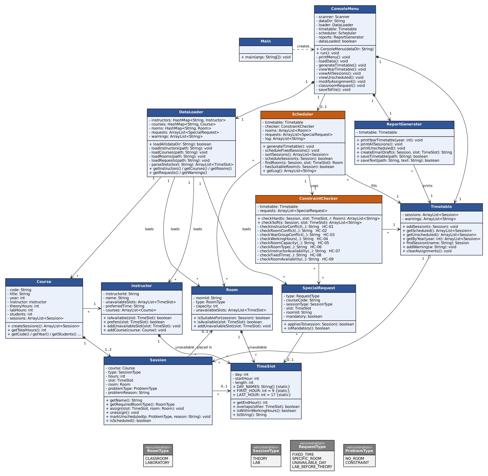
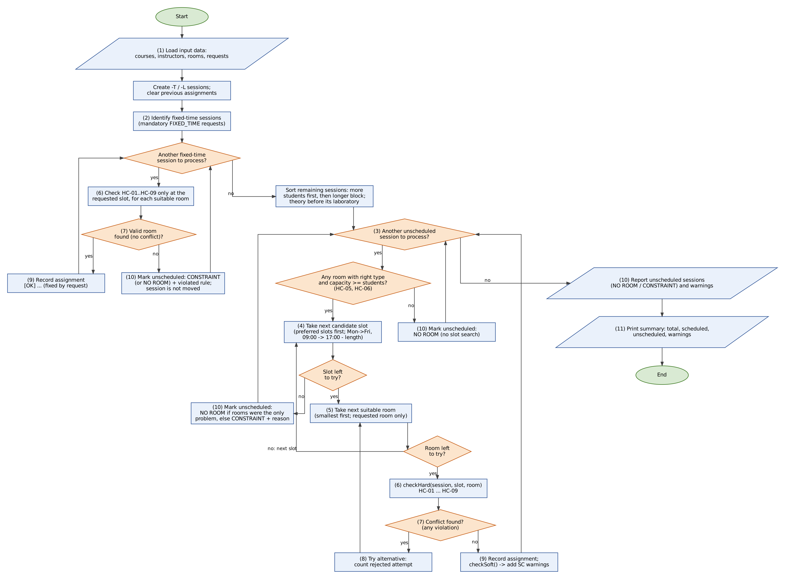

# Software Design Document (SDD)

## Cover

| Field | Value |
| :--- | :--- |
| **Project** | Department Course Timetable Management System |
| **Document** | Software Design Document |
| **Version** | v2 |
| **Related SRS version** | v2 |
| **Date** | 10.11.2026 |
| **Team** | Arda Güneş (`ardagunes1907`) · Elif Eylül Keskin (`keskinelifeylul`) |
| **Member 1** | Arda Güneş · `ardagunes1907` |
| **Member 2** | Elif Eylül Keskin · `keskinelifeylul` |
| **Repository** | https://github.com/keskinelifeylul/Department-Course-Timetable-Management-System- |

## Revision History

| Version | Date | Author(s) | Summary of changes |
| :--- | :--- | :--- | :--- |
| **v1** | 30.10.2026 | Arda Güneş, Elif Eylül Keskin | Initial class diagram and scheduling flowchart |
| **v2** | 10.11.2026 | Arda Güneş, Elif Eylül Keskin | Class diagram redrawn to match `code-v1` (17 types); flowchart redrawn; all sections completed: class descriptions, design decisions, strategy, limitations, conflict handling, UI, traceability (see Section 10) |
| **Final** | | | |

---

## 1. Introduction

This Software Design Document describes how the Department Course Timetable Management System is organized: its parts and classes, the main design decisions, the automatic scheduling algorithm and how conflicts are detected and handled. It is based on SRS v2 and matches the Java code tagged `code-v1`. It is written for the course instructor and for both team members, who use it to implement Code v2–v6.

---

## 2. System Overview

| Part | Classes | Responsibility |
| :--- | :--- | :--- |
| **User interface (menu and screens)** | `Main`, `ConsoleMenu` | Starts the program, shows the main menu (Screen 1), reads the coordinator's input and calls the right operation. |
| **Input (reading and validating files)** | `DataLoader` | Reads the four input files, validates every field, creates the domain objects and collects warnings. |
| **Domain model (courses, instructors, rooms, sessions, time slots)** | `Course`, `Instructor`, `Room`, `Session`, `TimeSlot`, `SpecialRequest`; enumerations `SessionType`, `RoomType`, `RequestType`, `ProblemType` | Represent the data of the timetable problem and answer simple questions about themselves (e.g. `Room.isAvailable`). |
| **Scheduling (algorithm and constraint checks)** | `Scheduler`, `ConstraintChecker`, `Timetable` | `Scheduler` places the sessions; `ConstraintChecker` checks `HC-01`–`HC-09` and `SC-01`–`SC-04`; `Timetable` stores all sessions and warnings. |
| **Output (timetables, reports, email draft)** | `ReportGenerator` | Prints the timetable views and reports and saves the timetable and email drafts to `output/`. |

---

## 3. UML Class Diagram



*Tool used: Graphviz (`dot`), generated from our class list · Source file: `docs/design/class_diagram.dot` · Orange classes run the scheduling algorithm.*

- [x] Every main class is shown, named exactly as in the Java code
- [x] Important attributes have a type and visibility, e.g. `- capacity: int`
- [x] Main methods have parameters and a return type, e.g. `+ isAvailable(slot: TimeSlot): boolean`
- [x] Relationships between classes are drawn, with multiplicities
- [x] The class that runs the scheduling algorithm is identifiable
- [x] The diagram is readable when printed on one A4 page

---

## 4. Class Descriptions

| Class | Responsibility (one sentence) | Key attributes | Key methods | Related classes |
| :--- | :--- | :--- | :--- | :--- |
| `Main` | Starts the application by creating a `ConsoleMenu` and calling `run()`. | — | `+ main(args: String[]): void` | `ConsoleMenu` |
| `ConsoleMenu` | Shows the main menu, reads the coordinator's choices and calls the matching operation. | `- scanner: Scanner`; `- dataDir: String`; `- loader: DataLoader`; `- timetable: Timetable`; `- scheduler: Scheduler`; `- reports: ReportGenerator`; `- dataLoaded: boolean` | `+ run(): void`; `- loadData()`; `- generateTimetable()`; `- modifyAssignment()`; `- classroomRequest()`; … | `DataLoader`, `Timetable`, `Scheduler`, `ReportGenerator` |
| `DataLoader` | Reads and validates the four input files and builds the domain objects. | `- instructors, courses, rooms: HashMap<String, …>`; `- requests: ArrayList<SpecialRequest>`; `- warnings: ArrayList<String>` | `+ loadAll(dataDir: String): boolean`; `- loadCourses(path)`; `- parseSlots(text): ArrayList<TimeSlot>` | `Course`, `Instructor`, `Room`, `SpecialRequest` |
| `Course` | Stores one course and creates its theory and laboratory sessions. | `- code, title: String`; `- year: int`; `- instructor: Instructor`; `- theoryHours, labHours, students: int`; `- sessions: ArrayList<Session>` | `+ createSessions(): ArrayList<Session>`; `+ getTotalHours(): int` | `Instructor`, `Session` |
| `Instructor` | Stores an instructor with their courses, unavailable periods and preferred time. | `- instructorId, name: String`; `- unavailableSlots: ArrayList<TimeSlot>`; `- preferredTime: String`; `- courses: ArrayList<Course>` | `+ isAvailable(slot: TimeSlot): boolean`; `+ prefers(slot: TimeSlot): boolean` | `Course`, `TimeSlot` |
| `Room` | Stores a classroom or laboratory and answers whether it suits a session and is available. | `- roomId: String`; `- type: RoomType`; `- capacity: int`; `- unavailableSlots: ArrayList<TimeSlot>` | `+ isSuitableFor(session: Session): boolean`; `+ isAvailable(slot: TimeSlot): boolean` | `Session`, `TimeSlot`, `RoomType` |
| `Session` | Represents one block (`-T` or `-L`) and holds its placement or the reason it is unscheduled. | `- course: Course`; `- type: SessionType`; `- hours: int`; `- slot: TimeSlot`; `- room: Room`; `- problemType: ProblemType`; `- problemReason: String` | `+ getName(): String`; `+ assign(slot, room): void`; `+ markUnscheduled(p, reason): void`; `+ isScheduled(): boolean` | `Course`, `Room`, `TimeSlot` |
| `TimeSlot` | Represents a day, start hour and length and compares two periods. | `- day: int` (`0 = Mon`); `- startHour: int`; `- length: int` | `+ overlaps(other: TimeSlot): boolean`; `+ isWithinWorkingHours(): boolean`; `+ getEndHour(): int` | `Session`, `Instructor`, `Room`, `SpecialRequest` |
| `SpecialRequest` | Stores one special request from `constraints.txt` and whether it is mandatory. | `- type: RequestType`; `- courseCode: String`; `- sessionType: SessionType`; `- slot: TimeSlot`; `- roomId: String`; `- mandatory: boolean` | `+ appliesTo(session: Session): boolean`; `+ isMandatory(): boolean` | `Session`, `TimeSlot` |
| `Timetable` | Keeps the list of all sessions and the warnings, and filters it for the views. | `- sessions: ArrayList<Session>`; `- warnings: ArrayList<String>` | `+ getScheduled()`; `+ getUnscheduled()`; `+ getByYear(year: int)`; `+ findSession(name: String)`; `+ clearAssignments()` | `Session` |
| `Scheduler` | Runs the automatic scheduling algorithm of Section 6. | `- timetable: Timetable`; `- checker: ConstraintChecker`; `- rooms: ArrayList<Room>`; `- requests: ArrayList<SpecialRequest>`; `- log: ArrayList<String>` | `+ generateTimetable(): void`; `- scheduleFixedSessions()`; `- sortSessions()`; `- scheduleSession(s): boolean`; `- findRoom(s, slot): Room` | `Timetable`, `ConstraintChecker`, `Room`, `SpecialRequest` |
| `ConstraintChecker` | Checks every hard and soft constraint for a proposed placement, for both automatic and manual changes. | `- timetable: Timetable`; `- requests: ArrayList<SpecialRequest>` | `+ checkHard(s, slot, room): ArrayList<String>`; `+ checkSoft(s, slot): ArrayList<String>`; one private method per HC | `Timetable`, `SpecialRequest`, `Session`, `Room`, `TimeSlot` |
| `ReportGenerator` | Prints the timetable views and reports and writes them and the email drafts to files. | `- timetable: Timetable` | `+ printYearTimetable(year: int)`; `+ printUnscheduled()`; `+ createEmailDraft(s, slot): String`; `+ saveTimetable(path): boolean` | `Timetable`, `Session` |
| `SessionType`, `RoomType`, `RequestType`, `ProblemType` | Enumerations that give fixed names to the session kinds, room kinds, request kinds and problem kinds. | `THEORY, LAB` · `CLASSROOM, LABORATORY` · `FIXED_TIME, SPECIFIC_ROOM, UNAVAILABLE_DAY, LAB_BEFORE_THEORY` · `NO_ROOM, CONSTRAINT` | — | `Session`, `Room`, `SpecialRequest` |

---

## 5. Design Decisions

| Question | Our decision | Why |
| :--- | :--- | :--- |
| **How is a course split into sessions (theory and laboratory blocks)?** | `Course.createSessions()` creates at most two `Session` objects: one `THEORY` session with all theory hours and one `LAB` session with all laboratory hours. A block with 0 hours is not created. Sessions are named with the suffix `-T` or `-L` (e.g. `SENG201-T`, `SENG201-L`). | The project allows theory and lab hours to be treated as separate blocks. Keeping one block per type is the simplest approach and matches the example screens. Each block is placed whole, on one day. |
| **How is a time slot represented (day, start hour, length)?** | A `TimeSlot` object has three `int` fields: `day` (`0 = Monday … 4 = Friday`), `startHour` (`9–16`) and `length` (hours). The end hour is `startHour + length`. Two slots overlap if they are on the same day and each one starts before the other ends. | One class represents both a session's placement and unavailable periods, so all overlap checks use the same `overlaps()` method. Integers make comparisons simple. |
| **How is the timetable stored (per year group, per room, per instructor)?** | `Timetable` keeps one `ArrayList<Session>` with all sessions. Each `Session` stores its own `TimeSlot` and `Room`, or the reason it is unscheduled. Views per year group, room or instructor are created by filtering this list. | There is a single source of truth, so different structures never get out of sync. The dataset is small, so filtering the list is fast enough. |
| **How are instructor and room availability stored?** | `Instructor` and `Room` each have an `ArrayList<TimeSlot>` of unavailable periods. A whole unavailable day is stored as one slot from `09:00` with length `8`. An `UNAVAILABLE_DAY` request adds such a slot to the instructor. The preferred time is a `String` (`MORNING`, `AFTERNOON` or `NONE`), checked by `Instructor.prefers()`. | Availability checks reuse `TimeSlot.overlaps()`, so no extra logic is needed. A simple word is enough for the preference, because the project only needs a basic approach to preferences. |
| **How are special requests represented and marked as mandatory or preferred?** | Each line of `constraints.txt` becomes a `SpecialRequest` with a `RequestType` (`FIXED_TIME`, `SPECIFIC_ROOM`, `UNAVAILABLE_DAY`, `LAB_BEFORE_THEORY`), the course code, the session type (`T`, `L` or `-` for the whole course), an optional `TimeSlot` or room ID, and a `boolean mandatory` that comes from the keyword `MANDATORY` or `PREFERRED`. | One class for all request types keeps loading and checking simple. The boolean flag lets the checker treat mandatory requests as hard constraints and preferred ones as soft constraints. |
| **How are hard constraints checked (one method per constraint, one checker class, …)?** | All checks are in one class, `ConstraintChecker`, with one private method per constraint (`HC-01` to `HC-09`). `checkHard(session, slot, room)` calls all of them and returns a list of violation messages; an empty list means the placement is valid. `Scheduler` and the manual modification in `ConsoleMenu` both call this method. | The project requires manual changes to use the same checks as automatic scheduling. One method per constraint makes each rule easy to test and explain, and the messages are used directly in reports. |
| **How are input errors detected and reported?** | `DataLoader` reads each file line by line. For each line it checks the number of fields, parses numbers inside `try-catch` (`NumberFormatException`), and checks that referenced courses, instructors and rooms exist. An invalid line is skipped and a warning with the file name and line number is added to a list. A missing file is caught (`FileNotFoundException`) and reported without terminating. | The program must never crash on bad input (`NFR-01`). Collecting warnings in a list lets the system show them all together after loading, as in Screen 2. |
| **Which collections (arrays, `ArrayList`, `HashMap`, …) are used, and for what?** | `ArrayList` holds sessions, rooms, requests, time slots and messages. `HashMap<String, Course>`, `HashMap<String, Instructor>` and `HashMap<String, Room>` store loaded objects by code or ID. A `String[]` holds the fields of a split line and the day names (`TimeSlot.DAY_NAMES`). Enumerations replace `String` constants for session, room, request and problem types. | `ArrayList` suits lists that grow and are processed in order. `HashMap` gives fast lookup by ID when checking references during loading. Enumerations prevent spelling errors such as `"Lab"` vs `"LAB"`. |

---

## 6. Automatic Scheduling Algorithm

### 6.1 Strategy

- **In what order are sessions processed?** Mandatory fixed-time sessions first; then all other sessions by number of students (largest first), then by length (longer first), with a course's theory session always before its laboratory session.
- **How are candidate time slots selected?** Day by day from Monday to Friday and hour by hour from `09:00` up to `17:00` minus the session length; slots in the instructor's preferred part of the day and, for a laboratory, slots after the theory session are tried first.
- **How are suitable rooms selected?** Only rooms of the required type (`Classroom` for theory, `Laboratory` for laboratory) with `capacity >= students`, sorted by capacity from smallest to largest; with a specific-room request, only that room.
- **How are scheduling constraints checked?** For each slot and room, `ConstraintChecker.checkHard()` runs the nine HC methods and returns the violations; the combination is accepted only if the list is empty. `checkSoft()` is called on the accepted combination.
- **How are conflicts handled, and which alternatives are tried in what order?** On a violation the next suitable room for the same slot is tried, then the next slot; already placed sessions are never moved (no backtracking). A fixed-time session is never moved to another slot.
- **When does the algorithm decide that a session cannot be assigned?** At once if no room of the right type and capacity exists (`NO ROOM`); otherwise after all slots and rooms were tried (`NO ROOM` if the rooms were the only problem, else `CONSTRAINT`). A fixed-time session fails as soon as its requested slot is invalid.

### 6.2 Flowchart



*Figure 6.2 Automatic scheduling algorithm. Numbers in brackets are the 11 required elements. Source file: `docs/design/flowchart.dot`*

- [x] 1. Loading input data
- [x] 2. Identifying fixed-time sessions
- [x] 3. Selecting an unscheduled session
- [x] 4. Searching for an available time slot
- [x] 5. Searching for a suitable room
- [x] 6. Checking scheduling constraints
- [x] 7. Detecting conflicts
- [x] 8. Trying alternatives
- [x] 9. Recording successful assignments
- [x] 10. Reporting unscheduled sessions
- [x] 11. Completing the timetable generation process

### 6.3 Pseudocode (optional)

```text
generateTimetable():
    timetable.clearAssignments()
    for each mandatory FIXED_TIME request r:                  // step 1/2
        s = session of r
        room = first suitable room with checkHard(s, r.slot, room) empty
        if room found: s.assign(r.slot, room); log "[OK] ... (fixed by request)"
        else: s.markUnscheduled(CONSTRAINT or NO_ROOM, violations); log "[FAIL] ..."
    for each session s in sortSessions():                     // step 2/2
        if s already processed: continue
        if not hasSuitableRoom(s): s.markUnscheduled(NO_ROOM, "HC-05/HC-06 ..."); continue
        placed = false
        for each candidate slot in order (preferred first):
            for each suitable room (smallest first):
                if checkHard(s, slot, room) is empty:
                    s.assign(slot, room); add checkSoft(s, slot) to warnings
                    placed = true; break
                rejected = rejected + 1                       // try alternative
            if placed: break
        if not placed: s.markUnscheduled(NO_ROOM or CONSTRAINT, reason)
    print summary (total, scheduled, unscheduled, warnings)
```

### 6.4 Where Each Hard Constraint Is Checked

| ID | Constraint | Checked in (`Class.method`) | Code version |
| :--- | :--- | :--- | :--- |
| **HC-01** | Instructor conflict | `ConstraintChecker.checkInstructorConflict()` | Planned for v3 |
| **HC-02** | Room conflict | `ConstraintChecker.checkRoomConflict()` | Planned for v3 |
| **HC-03** | Year-group conflict | `ConstraintChecker.checkYearGroupConflict()` | Planned for v3 |
| **HC-04** | Working hours | `ConstraintChecker.checkWorkingHours()` → `TimeSlot.isWithinWorkingHours()` | Helper `TimeSlot.isWithinWorkingHours()` in `code-v1`; check planned for v3 |
| **HC-05** | Room capacity | `ConstraintChecker.checkRoomCapacity()` → `Room.isSuitableFor()` | Planned for v3 |
| **HC-06** | Room type | `ConstraintChecker.checkRoomType()` → `Room.isSuitableFor()` | Planned for v3 |
| **HC-07** | Instructor availability | `ConstraintChecker.checkInstructorAvailability()` → `Instructor.isAvailable()` | Helper `Instructor.isAvailable()` in `code-v1`; check planned for v5 |
| **HC-08** | Fixed-time requirements | `ConstraintChecker.checkFixedTime()`, `Scheduler.scheduleFixedSessions()` | Planned for v5 |
| **HC-09** | Room availability | `ConstraintChecker.checkRoomAvailability()` → `Room.isAvailable()` | Helper `Room.isAvailable()` in `code-v1`; check planned for v5 |

### 6.5 Known Limitations

- The algorithm is greedy: it places one session at a time at the first valid slot and room and never moves a session that is already placed. A session processed late may find no free slot although a valid timetable would exist if an earlier session had been placed elsewhere.
- Rooms are tried from the smallest suitable one, but slots are tried before rooms are compared across days, so a large room may be used early in the week by a session that could have used it later.
- A fixed-time session is checked only at its requested time; if a hard constraint fails there, it stays unscheduled even if the coordinator would accept another time.
- Soft constraints only change the order in which slots are tried; the algorithm does not compare different complete timetables, so the number of warnings is not minimised.
- A `NO ROOM` session (e.g. `SENG101-L` with 70 students and laboratories of at most 50 seats) can only be solved outside the system with a classroom request.

---

## 7. Conflict Detection and Handling

| Problem | Detected in (`Class.method`) | What the algorithm does | What the user sees |
| :--- | :--- | :--- | :--- |
| **Instructor or room already busy in the slot** | `ConstraintChecker.checkInstructorConflict()`, `ConstraintChecker.checkRoomConflict()` (called from `checkHard()`) | If the room is busy, it tries the next suitable room for the same slot. If the instructor is busy, no room can help, so it moves to the next start hour or day. It continues until a valid combination is found or all slots and rooms have been tried. | Nothing, if another valid slot or room is found; the line shows `(after N rejected attempts)`. If nothing works, the session is listed as unscheduled with type `CONSTRAINT` and the reason, e.g. `"HC-01: instructor Dr. Kaya is busy in all free slots"`. |
| **Year-group overlap** | `ConstraintChecker.checkYearGroupConflict()` (called from `checkHard()`) | It skips this slot and tries the next start hour or day, because changing the room cannot solve a year-group overlap. | Same as above: the session is placed elsewhere, or it is listed as unscheduled with type `CONSTRAINT` and reason `"HC-03: Year X has no free block of N hours"`. |
| **No room with enough capacity or the right type** | `Scheduler.hasSuitableRoom()` using `Room.isSuitableFor()` (`HC-05`, `HC-06`); later `ConstraintChecker.checkRoomConflict()` / `checkRoomAvailability()` | Before the time search, it checks whether any room of the right type and capacity exists. If none exists, the session is marked unscheduled with type `NO_ROOM` at once. If suitable rooms exist but are all busy or unavailable in every valid slot, it is also marked `NO_ROOM` after all slots are tried. | `[FAIL] SENG201-L HC-05: no laboratory with capacity >= 55` in Screen 3. The session is listed in Screen 5 with type `NO ROOM` and appears in option 7 for a classroom request. |
| **Fixed-time request violates a hard constraint** | `Scheduler.scheduleFixedSessions()`, using `ConstraintChecker.checkHard()` | It checks only the requested day and time and does not move the session elsewhere. If any hard constraint fails, the session is marked unscheduled with type `CONSTRAINT` and the violated constraint is recorded. No invalid assignment is made. | `[FAIL] SENG305-T Fixed time Fri 09:00-12:00 violates HC-07: instructor Dr. Sahin is unavailable on Friday` in Screen 3. Listed in Screen 5 with type `CONSTRAINT` and a note that the coordinator must resolve it. |
| **Soft-constraint violation** | `ConstraintChecker.checkSoft()` | Preferred slots are tried first, so most preferences are met without extra work. On the first valid combination `checkSoft()` is called; each violated SC is added to the timetable warnings and the assignment is kept. In a manual modification, the warning is shown and the coordinator is asked to confirm. | `[WARN] SENG401-T SC-02: Dr. Aksoy prefers mornings; placed at 13:00` in Screen 3, and the warning list in Screen 5. In Screen 6: `[!] SC-03 …` followed by `"Apply the change anyway? (y/n)"`. |
| **Specific-room request cannot be met** | `ConstraintChecker.checkHard()` with only the requested room, called from `Scheduler.scheduleSession()` | Only the requested room is tried at every slot; no other room is used, because the request is mandatory. | `[FAIL] SENG401-L SPECIFIC_ROOM B202: room busy or unavailable in all free slots`. Listed in Screen 5 with type `CONSTRAINT`. |

---

## 8. User Interface Design

| Menu option | What it does | Requirement IDs | `Class.method` called |
| :--- | :--- | :--- | :--- |
| **1. Load input data** | Reads the four files from `data/`, shows counts and warnings (Screen 2). | `FR-01`, `FR-02`, `FR-03`, `FR-09`–`FR-12` | `ConsoleMenu.loadData()` → `DataLoader.loadAll()` |
| **2. Generate timetable automatically** | Clears previous assignments and runs the algorithm; prints the log and summary (Screen 3). | `FR-04`, `FR-05`, `FR-13`–`FR-18`, `FR-25` | `ConsoleMenu.generateTimetable()` → `Scheduler.generateTimetable()` |
| **3. View timetable by year group** | Asks for a year (`1–4`) and prints its 5 × 8 grid and unscheduled sessions (Screen 4). | `FR-06` | `ReportGenerator.printYearTimetable()` |
| **4. View all scheduled sessions** | Lists every scheduled session with title, instructor, day, time and room. | `FR-19` | `ReportGenerator.printAllSessions()` |
| **5. View unscheduled sessions and warnings** | Lists unscheduled sessions with problem type and reason, then soft warnings (Screen 5). | `FR-20` | `ReportGenerator.printUnscheduled()` |
| **6. Modify / remove an assignment** | Moves a session to a new day, time and room after `checkHard()`/`checkSoft()`, or removes its assignment (Screen 6). | `FR-21`, `FR-22`, `FR-23` | `ConsoleMenu.modifyAssignment()` → `ConstraintChecker.checkHard()`, `checkSoft()` |
| **7. Generate classroom request email** | Lists `NO ROOM` sessions, suggests a time, shows the email draft and saves it on confirmation (Screen 7). | `FR-07`, `FR-24`, `FR-26` | `ConsoleMenu.classroomRequest()` → `ReportGenerator.createEmailDraft()`, `saveText()` |
| **8. Save timetable to file** | Writes all year-group timetables and the unscheduled list to `output/timetable.txt`. | `FR-08` | `ReportGenerator.saveTimetable()` |
| **0. Exit** | Ends the menu loop with `"Goodbye."` An invalid choice shows a message and the menu again. | `NFR-02` | `ConsoleMenu.run()` |

---

## 9. Requirements Traceability

| Requirement | Implemented in (`Class.method`) | Test case(s) | Status (planned / implemented / tested) |
| :--- | :--- | :--- | :--- |
| **FR-01** | `DataLoader.loadCourses()` | `TC-15`, `TC-12` | planned (v2) |
| **FR-02** | `DataLoader.loadCourses()`, `loadInstructors()`, `loadRooms()`, `loadRequests()` | `TC-12` | planned (v2) |
| **FR-03** | `DataLoader.loadInstructors()` | `TC-15` | planned (v2) |
| **FR-04** | `Scheduler.generateTimetable()`, `scheduleSession()` | `TC-01`, `TC-14` | planned (v3/v4) |
| **FR-05** | `ConstraintChecker.checkHard()` | `TC-02` – `TC-07` | planned (v3) |
| **FR-06** | `ReportGenerator.printYearTimetable()` | `TC-21` | planned (v4) |
| **FR-07** | `ReportGenerator.createEmailDraft()` | `TC-11` | planned (v6) |
| **FR-08** | `ReportGenerator.saveTimetable()` | `TC-21` | planned (v6) |
| **FR-09** | `DataLoader.loadRooms()` | `TC-15` | planned (v2) |
| **FR-10** | `DataLoader.loadRequests()` | `TC-15` | planned (v2) |
| **FR-11** | `DataLoader.loadAll()` | `TC-16` | planned (v2) |
| **FR-12** | `DataLoader.loadCourses()`, `loadRequests()` | `TC-12` | planned (v2) |
| **FR-13** | `Course.createSessions()` | `TC-01` | planned (v2) |
| **FR-14** | `Scheduler.scheduleFixedSessions()` | `TC-07` | planned (v5) |
| **FR-15** | `Scheduler.scheduleSession()`, `findRoom()` | `TC-09`, `TC-20` | planned (v3) |
| **FR-16** | `Session.markUnscheduled()`, `Scheduler.hasSuitableRoom()` | `TC-10`, `TC-05` | planned (v3) |
| **FR-17** | `ConstraintChecker.checkSoft()` | `TC-08`, `TC-14` | planned (v5) |
| **FR-18** | `Scheduler.getLog()`, `ConsoleMenu.generateTimetable()` | `TC-01` | planned (v4) |
| **FR-19** | `ReportGenerator.printAllSessions()` | `TC-21` | planned (v4) |
| **FR-20** | `ReportGenerator.printUnscheduled()` | `TC-10` | planned (v4) |
| **FR-21** | `ConsoleMenu.modifyAssignment()`, `ConstraintChecker.checkHard()` | `TC-13` | planned (v5) |
| **FR-22** | `ConsoleMenu.modifyAssignment()`, `ConstraintChecker.checkSoft()` | `TC-13` | planned (v5) |
| **FR-23** | `ConsoleMenu.modifyAssignment()`, `Session.markUnscheduled()` | `TC-13` | planned (v5) |
| **FR-24** | `ReportGenerator.saveText()` | `TC-11` | planned (v6) |
| **FR-25** | `Timetable.clearAssignments()`, `Scheduler.generateTimetable()` | `TC-22` | planned (v4) |
| **FR-26** | `ConsoleMenu.classroomRequest()` | `TC-11` | planned (v6) |
| **HC-01** | `ConstraintChecker.checkInstructorConflict()` | `TC-02` | planned (v3) |
| **HC-02** | `ConstraintChecker.checkRoomConflict()` | `TC-03` | planned (v3) |
| **HC-03** | `ConstraintChecker.checkYearGroupConflict()` | `TC-04` | planned (v3) |
| **HC-04** | `ConstraintChecker.checkWorkingHours()`, `TimeSlot.isWithinWorkingHours()` | `TC-17` | helper implemented (v1); check planned (v3) |
| **HC-05** | `ConstraintChecker.checkRoomCapacity()`, `Room.isSuitableFor()` | `TC-05` | planned (v3) |
| **HC-06** | `ConstraintChecker.checkRoomType()`, `Room.isSuitableFor()` | `TC-18` | planned (v3) |
| **HC-07** | `ConstraintChecker.checkInstructorAvailability()`, `Instructor.isAvailable()` | `TC-06` | helper implemented (v1); check planned (v5) |
| **HC-08** | `ConstraintChecker.checkFixedTime()`, `Scheduler.scheduleFixedSessions()` | `TC-07` | planned (v5) |
| **HC-09** | `ConstraintChecker.checkRoomAvailability()`, `Room.isAvailable()` | `TC-19` | helper implemented (v1); check planned (v5) |
| **NFR-01** | `DataLoader` (`try-catch` per line), `ConsoleMenu.run()` | `TC-12`, `TC-16` | planned (v2) |
| **NFR-02** | `ConsoleMenu.run()` | `TC-23` | implemented (v1) |
| **NFR-03** | `Scheduler.generateTimetable()` | `TC-25` | planned (v4) |
| **NFR-04** | whole project (standard library only) | `TC-24` | implemented (v1) |
| **NFR-05** | `ConstraintChecker` messages, `DataLoader` warnings | `TC-02`, `TC-12` | planned (v2/v3) |

---

## 10. Changes from the Previous Version

| Element | Change | Reason |
| :--- | :--- | :--- |
| **Class diagram (Section 3)** | Added as an image with 13 classes and 4 enumerations; v1 contained only the placeholder | Required for Checkpoint 1 and `code-v1` |
| **Menu, Filereader, DataVAlidator, Courd, TimetablePrinter** | Renamed/merged: `ConsoleMenu`; `DataLoader` (reading and validation together); `ReportGenerator` (printing and saving); typo `"Courd"` replaced by the domain classes | Names now match the Java files; validation needs the same line data as reading, so one class is simpler |
| **Session, TimeSlot, SpecialRequest, Timetable, ConstraintChecker** | Added to the class diagram and descriptions (Section 4 had only four rows) | They were already used in the design decisions of v1 |
| **Enumerations `SessionType`, `RoomType`, `RequestType`, `ProblemType`** | Added | Replace text constants such as `"LAB"` and make the `NO ROOM` / `CONSTRAINT` distinction explicit |
| **Room.roomName, Course.roomType, Instructor.availableDays** | Removed; `Room`/`Instructor` now store `unavailableSlots`; `Instructor.preferredSlots` replaced by `preferredTime` | Match SRS v2 Section 5 file formats and `HC-07`/`HC-09` |
| **Flowchart (6.2)** | Redrawn: separate loops for fixed-time and other sessions, room-existence check, slot loop and room loop with yes/no exits, alternative path, summary | In v1 the `"all sessions scheduled?"` decision led to the end on NO, and recording steps were duplicated |
| **Strategy (6.1), Conflicts (7)** | Changed from `"backtracking"` to first valid combination with alternatives; soft constraints handled by slot order plus warnings | The project does not require backtracking; the v1 answer did not match the pseudocode |
| **Pseudocode (6.3)** | Rewritten to match the new flowchart | Consistency |
| **Sections 6.5, 8, 9** | Completed: limitations, all nine menu options, traceability for every FR, HC and NFR | Required from v2 |

---

## AI-Use Declaration

| Tool | Used for | How we checked the result |
| :--- | :--- | :--- |
| **Claude (Anthropic AI assistant)** | Help with revising the v1 text into v2, wording requirements as testable sentences, drafting tables and generating the diagrams from our design | Both members read every row, compared it with the project description and with the Java code of `code-v1`, and corrected what we did not agree with. We can explain every requirement, class and diagram element ourselves. |
