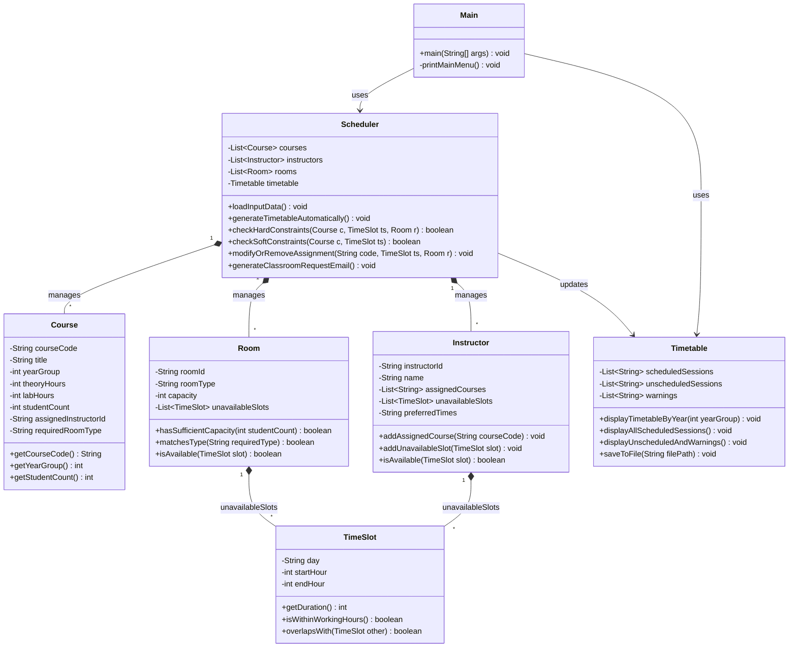
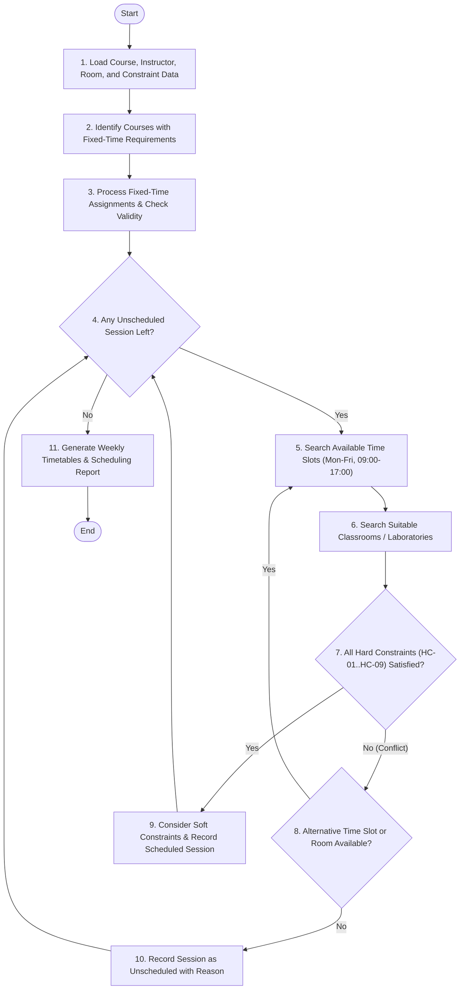

# Software Design Document (SDD v2 — Checkpoint 1 / Week 6)
**Project:** SENG 271 — Department Course Timetable Management System

---

## A. UML Class Diagram (Consistent with Code v1 Skeleton)

---

## B. Scheduling Algorithm Flowchart

