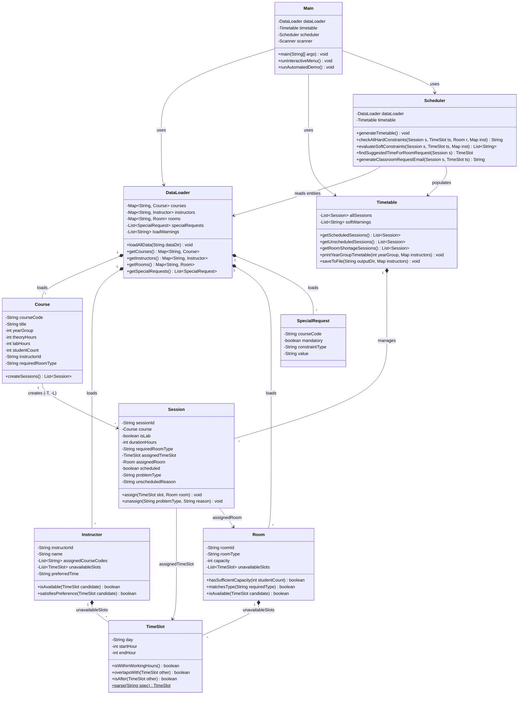
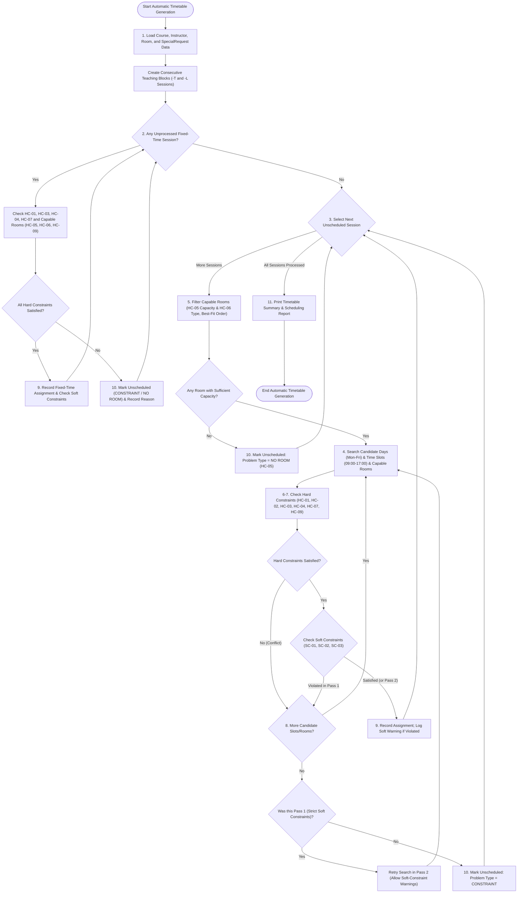

# Software Design Document (SDD — Final)
**Project:** SENG 271 — Department Course Timetable Management System

---

## 1. Architectural Overview & Revision History

| Version | Week | Summary of Design Updates |
| :--- | :---: | :--- |
| **SDD v1** | Week 4 | Initial UML Class Diagram and Scheduling Algorithm Flowchart. |
| **SDD v2** | Week 6 | Added `Session`, `SpecialRequest`, and `DataLoader` classes to separate file I/O from domain entities and support separate `-T` and `-L` blocks. |
| **SDD Final** | Week 13 | Updated `Scheduler` and `Timetable` methods to match final implementation including best-fit room selection, two-pass soft-constraint handling, manual modification verification, and classroom request email generation. |

---

## 2. A. UML Class Diagram

---

## 3. B. Scheduling Algorithm Flowchart

---

## 4. C. Class Descriptions

1. **`Main`**: Provides the console menu interface (Options 1–8 and 0) and coordinates user interactions and automated demonstration (`--demo`).
2. **`DataLoader`**: Parses `courses.csv`, `instructors.txt`, `rooms.csv`, and `constraints.txt`. Validates numeric fields and cross-references, logging clear warnings without terminating on faulty lines.
3. **`Course`**: Encapsulates curriculum metadata and generates `-T` (Theory) and `-L` (Laboratory) `Session` objects.
4. **`Session`**: Represents an atomic, consecutive teaching block to be scheduled into a `TimeSlot` and `Room`, storing assignment state or failure diagnostics (`NO ROOM` vs `CONSTRAINT`).
5. **`Instructor`**: Stores instructor identity, unavailable `TimeSlot` blocks, and morning/afternoon preferences.
6. **`Room`**: Represents a physical `Classroom` or `Laboratory` with student capacity and availability checks.
7. **`TimeSlot`**: Models a time interval on a working day (`Mon`–`Fri`, `09:00`–`17:00`) and provides overlap and ordering calculations.
8. **`SpecialRequest`**: Represents mandatory or preferred constraints loaded from `constraints.txt`.
9. **`Timetable`**: Maintains all scheduled and unscheduled sessions, formats year-group ASCII grids, and exports schedules to `.txt` and `.csv`.
10. **`Scheduler`**: Executes the 2-step automatic scheduling algorithm, checks hard (`HC-01`–`HC-09`) and soft (`SC-01`–`SC-04`) constraints, validates manual edits, and generates classroom request emails.

---

## 5. D. Key Design Decisions & Algorithm Limitations

1. **Best-Fit Room Selection**: Capable rooms are sorted in ascending order of capacity (`capacity >= students`). This prevents a 30-student class from occupying an 80-seat classroom (`A101`) that is needed by a 70-student class (`SENG101-T`).
2. **Two-Pass Soft-Constraint Resolution**: For each session, Pass 1 searches for a `(TimeSlot, Room)` pair that satisfies all hard constraints *and* all soft constraints (`SC-01`, `SC-02`, `SC-03`). If no ideal slot exists, Pass 2 places the session in the first hard-constraint-valid slot and records the corresponding soft-constraint warning.
3. **Greedy Rule-Based Limitation**: Because the algorithm assigns sessions sequentially without global backtracking, an early session assignment could occupy a slot needed by a later course. However, fixed-time requests are processed first (Step 1) and rooms use best-fit ordering to minimize greedy conflicts.

